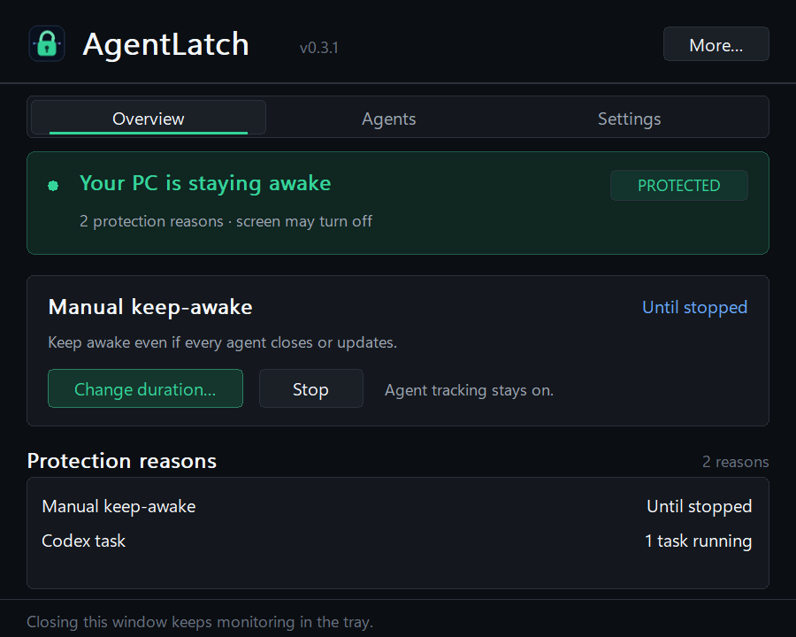
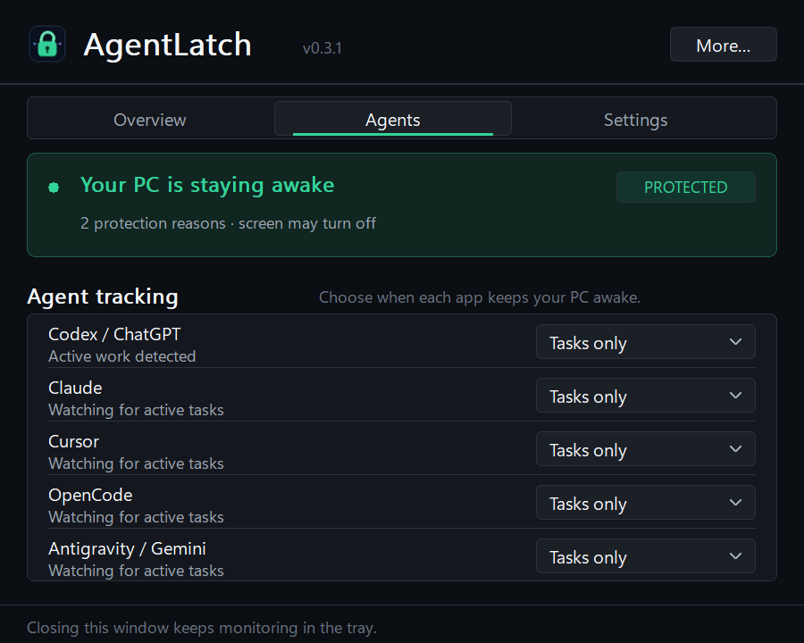
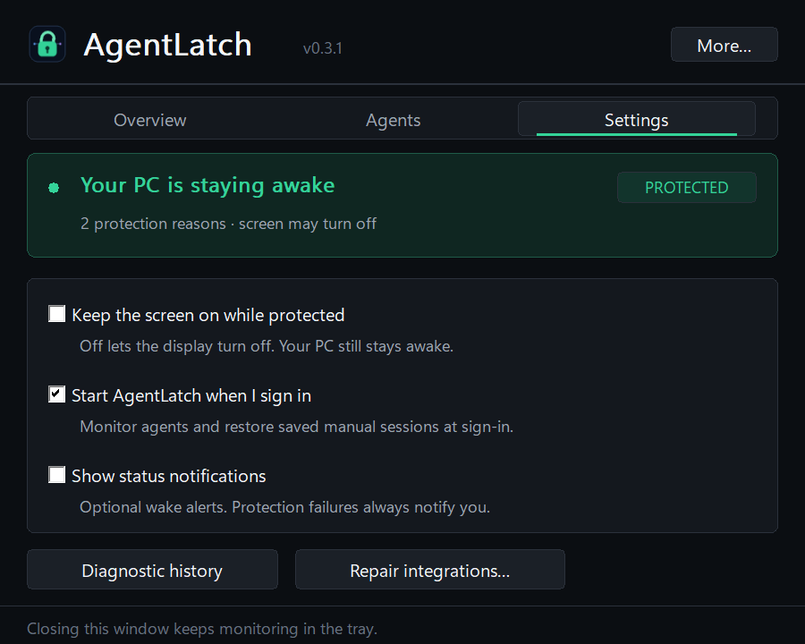

# Interface guide

AgentLatch 0.3 separates everyday actions from agent policy and system preferences. It remains a native Win32 tray utility, not a web page or WebView.

## Overview

The protection banner stays visible on every tab. **READY** means normal Windows idle-sleep policy applies; **PROTECTED** means Windows accepted AgentLatch's system power request; **ERROR** means a failed request is being retried. Accepted protection is not a guarantee against explicit Sleep, a forced restart, critical system policy, or power loss.

Use **Keep awake…** to choose Until stopped, a quick hour preset, or 1–168 custom hours. An active session shows its real remaining time or Until stopped. **Change duration…** replaces only that session. **Stop** leaves agent tracking and other reasons alone. Saved sessions restore across app restarts; timers retain their original end.

Cancel, Escape, or the custom-hours dialog's close button leaves the existing session unchanged.

The protection list contains every active source. Concurrent task counts are in the Status column, not confused with the number of source rows. The list supports selection, arrow keys, and its own scrolling when necessary. Activity grace and update/restart grace are labeled as grace, not running tasks or estimated completion times.

## Agents

Each provider has an explicit dropdown:

| Selection | Behavior |
|---|---|
| Tasks only | Track actual task signals; process activity is a qualified fallback. |
| While open | Protect while the app/CLI is detected, even without a task. |
| Off | Remove this provider's automatic protection; manual protection is independent. |

These map to `Tasks`, `Open`, and `Off` internally. A protected provider disappearing may retain its fixed ten-minute restart grace. A returning app follows the chosen mode again. Selecting a page is navigation only—it never changes tracking policy. Provider names are exposed as accessible names for their native dropdowns.

## Settings

- **Keep the screen on while protected:** affects the display request, not whether the PC itself stays awake.
- **Start AgentLatch when I sign in:** starts monitoring and restores a saved manual session after sign-in.
- **Show status notifications:** controls routine wake-state alerts. Protection failures still alert.

**Diagnostic history** opens the local bounded log. **Repair integrations…** is an intentional maintenance action, not a required first-run setup step. Neither action runs just by visiting Settings.

## Keyboard and tray behavior

Use Tab/Shift+Tab between native controls, Ctrl+Tab/Ctrl+Shift+Tab between pages, arrow keys on tabs/dropdowns/lists, Space for checkboxes, and Enter/Space for focused buttons. Focus indicators are visible. Closing the main window keeps monitoring in the tray; More… → Exit ends the process and its current power request, while preserving the saved manual choice for a later launch.

The preferred client size is 600 × 480 logical pixels. Native controls and typography scale with Windows DPI. The interface has no main-window scrollbar; long reason lists scroll within their own list.

## Capture provenance and validation

The documentation images are off-screen exports of the running app's current state through `--export-ui-screenshots`. They use the same renderer, child windows, labels, and settings as the visible UI. They are not photographs of the desktop, mock data, or evidence of a completed provider task.

Export creates only a hidden `WS_EX_NOACTIVATE` capture window and never changes the visible page, input focus, mouse, keyboard, or system power plan. Output stays local until a user explicitly publishes it. Review any custom external-lease labels before sharing.

Automated native tests cover page visibility, mode mapping, all-reason lists, tab fit without overflow arrows, control bounds, and off-screen renders at 96/120/144/168/192 DPI (100–200% scaling). Fixtures include timed, indefinite, idle, error, and long-list states.

Custom-painted tabs, collapsed provider dropdowns, and rounded buttons paint their full rectangular background before their rounded foreground. Independent control tests start with white and magenta pixels and verify all outer corners, including pressed/focused button states and both print paths. This catches artifacts that a pre-painted whole-dashboard export can conceal. Reason columns also adjust to the actual client width when vertical scrolling is needed, without adding a horizontal scrollbar.

These checks establish UI structure/rendering, not overnight or provider-specific lifecycle qualification. They do not activate a visible window or send mouse/keyboard input.
