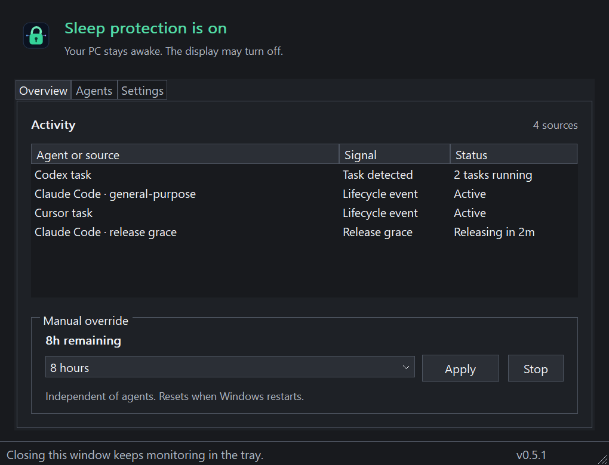
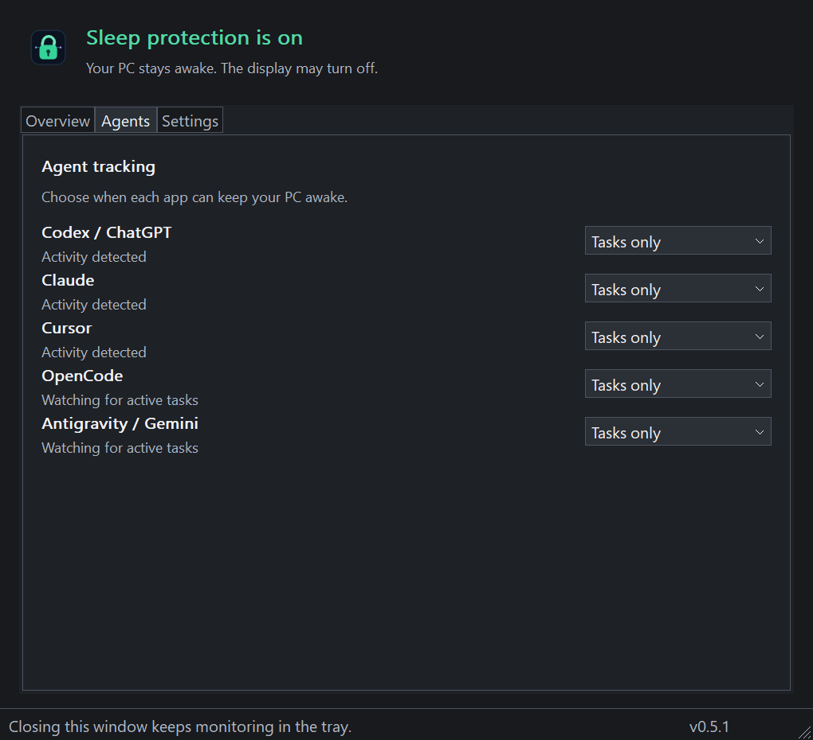
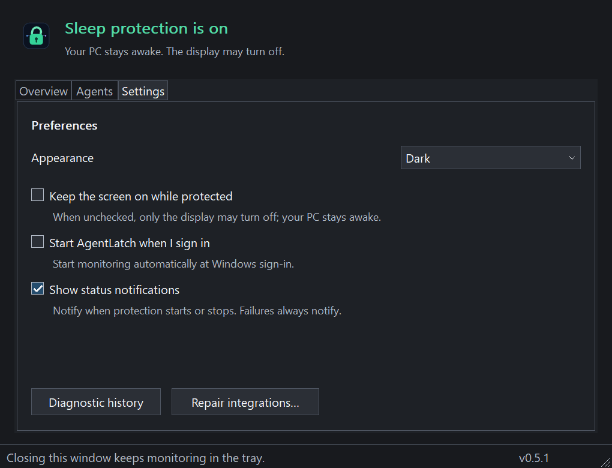

# Interface guide

AgentLatch 0.5 uses Windows common controls: standard tabs, buttons, dropdowns, checkboxes, an activity table and a status bar. It remains a small Win32 tray utility, without a web runtime or an added UI framework. The images below are high-resolution off-screen exports of the running release candidate.

Windows owns the title bar, app icon, minimize/maximize/close buttons, system menu, resize border and window snapping. There is no custom caption button row and no duplicate in-content app-name header or More button. The version remains in the native caption and status bar. The tray right-click menu is the single command hub; closing hides the window without stopping monitoring. Light mode uses Windows visual styles. Dark mode retains native HWND input/accessibility and paints dark surfaces using public Win32 APIs; no private dark-mode ordinals are loaded. Windows high contrast takes priority over app appearance.

## Overview

The protection summary stays visible on every tab, without a redundant status badge. **Ready when your agents are** means normal Windows idle-sleep policy applies; **Sleep protection is on** means Windows accepted AgentLatch's system power request; **Sleep protection needs attention** means a failed request is being retried. READY/PROTECTED/ERROR remain the tray/diagnostic terms. Accepted protection is not a guarantee against explicit Sleep, a forced restart, critical system policy, or power loss.

Use **Keep awake…** in the bottom **Manual override** strip to choose **Until Windows restarts**, a quick hour preset, or 1–168 custom hours. An active session shows its real remaining time or Until Windows restarts. **Change…** replaces only that session. **Stop** leaves agent tracking and other reasons alone. Both timed and unlimited manual overrides reset after restarting Windows; enable them again when needed. App-only restarts/updates preserve the same-session choice and original timer end. Signing out can also clear it when Windows unloads the user registry hive; ordinary sleep/hibernate does not. Legacy permanent manual settings are not restored on upgrade.

Cancel, Escape, or the custom-hours dialog's close button leaves the existing session unchanged.

The activity table has named **Agent or source**, **Signal** and **Status** columns. It displays every current source using normal native selection, keyboard navigation and vertical scrolling. There are no custom page arrows or five-row limit. Column widths track the window size without horizontal scrolling, and unchanged refreshes preserve the current selection and scroll position. Long names use the native list's ellipsis/label-tip behavior rather than overlapping adjacent columns.

The source count is the number of agent/custom activity rows, not a total task count. One Codex source can contain multiple tasks. The built-in manual session appears only in its separate native group, so it is not duplicated or counted as an agent. Custom external requests remain visible even when their source key is `manual`. An empty-state message explains when manual override alone is keeping the PC awake. The Stop button remains in place but is disabled when manual override is off. Activity/restart grace is labeled as grace, not running tasks or predicted completion times.

CPU/I/O fallback evidence shows **Process activity**, not a verified task count. While such activity continues it is not labeled as release grace. **Releasing in…** is the remaining quiet-period or restart grace, never an estimate of how long a model will work. Fresh activity exits grace and restores the activity label. Claude workers have separate rows and are reconciled against its current in-flight background summary; merely creating a to-do does not produce a running row.

## Agents

Each provider has an explicit dropdown:

| Selection | Behavior |
|---|---|
| Tasks only | Track actual task signals; process activity is a qualified fallback. |
| While open | Protect while the app/CLI is detected, even without a task. |
| Off | Remove this provider's automatic protection; manual protection is independent. |

These map to `Tasks`, `Open`, and `Off` internally. A protected provider disappearing may retain its fixed ten-minute restart grace. A returning app follows the chosen mode again. Selecting a page is navigation only—it never changes tracking policy. Provider names are exposed as accessible names for their native dropdowns.

## Settings

- **Appearance:** Use Windows setting (default), Light or Dark. Changes apply immediately and persist without changing agent modes, timers or the Windows theme. If the Windows app-color preference cannot be read, System falls back to Light. High contrast overrides all three choices.
- **Keep the screen on while protected:** affects the display request, not whether the PC itself stays awake.
- **Start AgentLatch when I sign in:** starts agent monitoring automatically. Manual override remains Off after a Windows restart until you enable it again.
- **Show status notifications:** controls routine wake-state alerts. Protection failures still alert.

Each preference uses a standard Windows checkbox with a clear label and explanation. Checked means enabled. Windows owns checked/focus/disabled states, keyboard activation and accessibility. **Diagnostic history** opens the local bounded log. **Repair integrations…** is intentional maintenance, not required first-run setup. Neither runs just by visiting Settings.

## Keyboard and tray behavior

Use Tab/Shift+Tab between controls, Ctrl+Tab/Ctrl+Shift+Tab between pages, arrow keys on tabs/dropdowns/lists, Space for checkboxes, and Enter/Space for focused buttons. Closing the main window keeps monitoring in the tray; right-click the tray icon and choose **Exit** to end the process/power request, while preserving a manual choice only for later launch within the same Windows session.

The preferred client is 680 × 520 logical pixels, with a 600 × 460 minimum. Resize or maximize it using the native Windows frame. The activity list gains a normal vertical scrollbar when needed; the whole window does not become a scrolling page. Keyboard focus and hover/press/disabled states remain visible in both themes.

## Capture provenance and validation

The documentation images are off-screen exports of the running app's current state through `--export-ui-screenshots`. They use the same renderer, child windows, labels, and settings as the visible UI. They are not photographs of the desktop, mock data, or evidence of a completed provider task.

Export creates only a hidden `WS_EX_NOACTIVATE` capture window and never changes the visible page, input focus, mouse, keyboard, or system power plan. Output stays local until a user explicitly publishes it. Review any custom external-lease labels before sharing.

Automated tests cover page visibility, mode mapping, native control/window styles, every activity row, selection/scroll preservation, checkbox state, no More/duplicate header, three client sizes and no horizontal scrolling. Both themes exercise layout/font scales at 96/120/144/168/192 DPI, creating 180 timed, indefinite, idle, error, long-list and mixed-source fixtures. Tests do not move visible windows between monitors or qualify real DWM rendering on every monitor. System-owned menus and message boxes retain Windows' own appearance.

Light controls use Windows drawing; dark controls keep native behavior while painting a consistent dark palette, including table headers and scrollbar surfaces. Labels match the pane background and dropdowns retain explicit accessible names. Hidden tests cover selected themes/modes, persistence, text contrast, full corner painting, native frame styles and dark custom-hours validation. The exporter paints panes back-to-front and can restore omitted hidden dropdown text from its actual value.

`scripts/capture-dashboard.ps1 -Theme Light` or `-Theme Dark` exports a theme-specific hidden clone from the same live state without changing the visible theme or saved preference. Exports show only the app's client area, not Windows' DWM title bar. Theme-forced screenshots show the clone's appearance selection, not necessarily the user's saved choice.

These checks establish UI structure/rendering, not overnight or provider-specific lifecycle qualification. They do not activate a visible window or send mouse/keyboard input.
