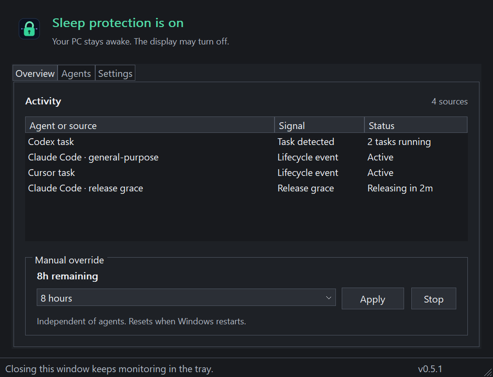
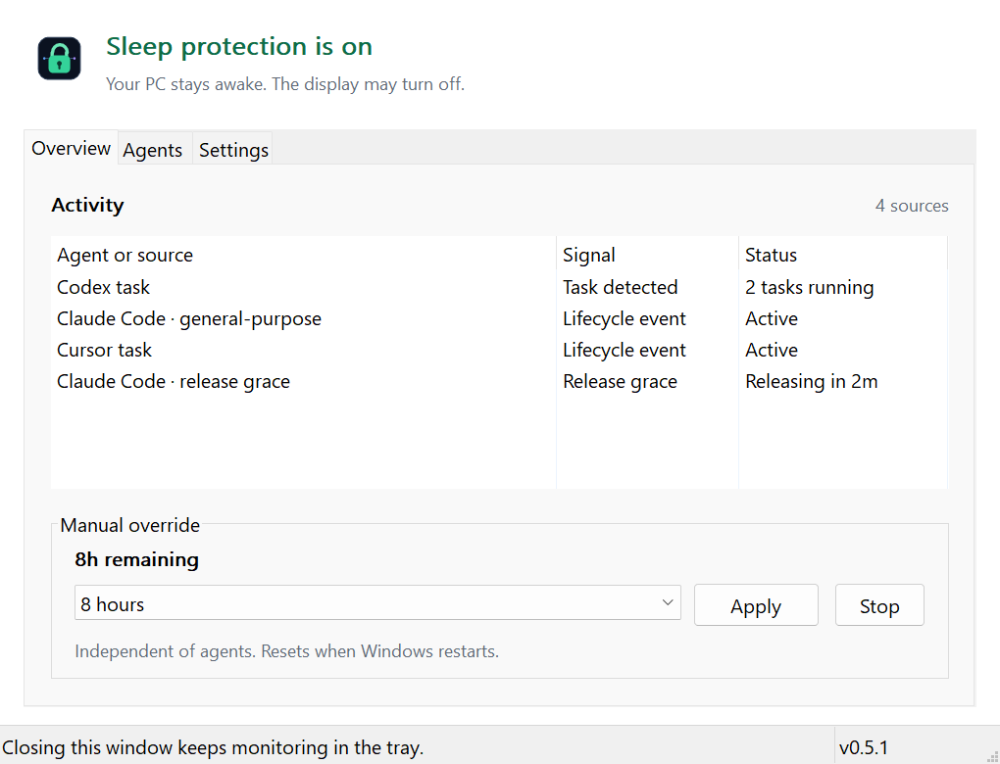

# Direct manual controls and read-only activity

Available in **0.5.1**. The title bar and status bar show the installed version. If you still see 0.5.0, install the latest setup executable from the [GitHub release page](https://github.com/byassin/agent-latch/releases/latest).

## Manual override

On **Overview**, choose a duration directly in the **Manual override** group:

- **Until Windows restarts**, or a preset of 1, 2, 4, 8, 12 or 24 hours.
- **Custom hours**, then enter a whole number from **1 to 168** in the field that appears.

Click **Start** to enable the override. While it is active, choose a replacement duration and click **Apply**; the new duration starts from that moment. Choosing or typing a duration alone does not change protection. Monitoring refreshes do not discard an unapplied choice. Invalid input shows an explanation below the controls and leaves the existing session unchanged.

The current state/countdown is separate from the duration you are choosing. **Stop** ends only the manual session, not automatic agent protection. The tray's quick-duration menu still works. Both timed and unlimited sessions reset after Windows restarts; app-only restarts retain the session and its original end time.

## Read-only activity

Activity is a live status list, not a selection box. Each row shows its source, signal and status. Clicking does not select or highlight a row; there is no details pane. The list is skipped by Tab navigation so it does not suggest a row action. Use the mouse wheel or its native scrollbar when there are more sources than fit on screen. Monitoring refreshes preserve the scroll position.

Some sources aggregate several tasks. The count is real detection metadata; it is not a list of individual task names. AgentLatch does not read chat prompts or responses, and does not invent missing task details. An Active status is not a task-completion estimate. A release-grace countdown describes protection timing only.

## Light and dark previews

These lossless 1020 × 780 PNGs are **synthetic test fixtures**, rendered from the actual hidden native controls at 150% layout scale. Their example activity demonstrates the interface, not live agent activity or overnight protection.

The preferred client remains 680 × 520 logical pixels, with a 600 × 460 minimum. The activity list scrolls normally without making the whole window a scrolling page.

## Verification boundaries

The release checks include a disposable-runner Claude hook/IPC test that acquires protection, handles background workers, releases the final latch after settling grace, and clears the Windows power request. Installed diagnostics can show live Claude background snapshots and Codex activity; they are not an exhaustive live completion test of every provider session.

The self-test covers manual preset/custom validation and draft preservation, rejected row selection, sibling hit-target checks and concurrent Codex parent/worker directory-scanning cases. Native UI checks run in light/dark themes at 100%, 125%, 150%, 175% and 200% layout scales. The Codex cases confirm the scanner clears final completion before the separately tested detector grace expires.

The blank manual panel in 0.5.0 was a separate paint-clipping bug: its sibling frame could draw over the controls. A repaint regression creates its windows on a separate test desktop that is **never switched to or activated**. It verifies that the frame's real paint DC excludes every visible manual field/button after tab changes and container-only repaints. This test fails without sibling clipping and passes with it. It does not send input or show windows on your working desktop; screenshot export alone would not catch this bug.

Off-screen screenshot exports do not change tabs or preferences in the running dashboard. None of these checks controls the working desktop or proves that Windows cannot be explicitly shut down, restarted or put to sleep.
